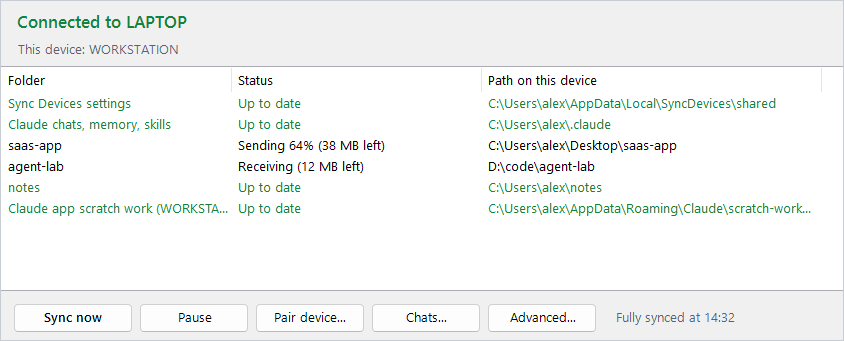

# Sync Devices: sync Claude Code chats, memory and projects between your Windows PCs

[](LICENSE)


[](https://syncthing.net)

**Path-remapped peer-to-peer sync of Claude Code state across your machines.**
Start a Claude Code chat on your desktop, continue it on your laptop. Sync Devices keeps every folder
your chats worked in, the chats themselves, memory and skills in sync, in both directions.
No server, no account, no cloud copy.



## Why

Claude Code keeps chats and memory on the machine where they happened, in a folder named after the
project's absolute path. Move to your laptop and that context is gone. Git only moves what you
commit, and private files often never get committed.

Sync Devices keeps every folder a Claude chat touched, and the chats, in sync between your machines.
You open the laptop and continue the chat you started on the desktop.

## What it does

- **Finds the folders.** Setup reads your Claude Code transcripts, lists every folder a chat worked in
  or touched a file in, and lets you pick which to sync.
- **Syncs them peer to peer.** [Syncthing](https://syncthing.net) moves the files directly between
  your machines, TLS-encrypted, across any network. Nothing is stored on a server.
- **Syncs Claude's own state.** From `~\.claude`: `projects` (chats and memory), `skills`, `plans`,
  `agents`, `commands`, `CLAUDE.md`. Not `settings.json` or plugins; those stay per machine.
- **Lines up the chats.** See [How chats line up](#how-chats-line-up).
- **Tray app.** Shows each folder's status, has **Sync now**, **Pause**, **Pair device**, and a
  **Chats** list that continues any chat on the current machine with `claude --resume`.
- **Safe by default.**
  - A joining machine renames its existing copy of a folder to `<name>.before-sync-<date>` instead of mixing it.
  - Deleted or replaced files stay in each folder's `.stversions` for 30 days.
  - After the first pairing, a pairing request from an unknown device gets no Accept button.
  - Folders are shared only with machines paired through Sync Devices, never with other Syncthing devices you have.

## Requirements

- Windows 10 or 11 with Windows PowerShell 5.1 (built in) and winget (App Installer).
- Claude Code (the CLI or the desktop app) on each machine.
- Syncthing. Setup installs it with winget if it is missing.

## Quick start

**First machine.** In PowerShell, in this folder:

```powershell
powershell -ExecutionPolicy Bypass -File .\Setup-SyncDevices.ps1
```

Tick the folders to sync in the window that opens. Setup prints this machine's device ID.

**Each other machine.** Close editors and terminals that have the synced folders open, then run:

```powershell
powershell -ExecutionPolicy Bypass -File .\Setup-SyncDevices.ps1 -Join <first machine's device ID>
```

On the first machine, open Sync Devices, click **Accept**, and type the first 7 characters of the
device ID that the joining machine printed. The joining machine receives the folder list, keeps its
old copies as backups, and starts to sync.

If Windows asks whether Syncthing may use the network, allow it on private networks.

## How chats line up

Claude Code stores a project's chats in `~\.claude\projects\<key>`, where the key is the project's
absolute path with every non-alphanumeric character replaced by `-`. The same project therefore has a
different key on each machine when the user name or folder layout differs.

```
first machine (canonical)                    other machine
~\.claude\projects\                          ~\.claude\projects\
  C--Users-alex-Desktop-app\  <== syncs ==>    C--Users-alex-Desktop-app\    real folder
                                               C--Users-sam-Desktop-app\  -> junction to the folder above
```

The first machine's keys are canonical. On every other machine, Sync Devices turns the local key into
a junction to the canonical folder. Both machines then read and write the same transcripts and memory,
so `claude --resume <id>` works on either one. A chat folder that is open at that moment is linked
on the next run (every 5 minutes, or when you click **Sync now**).

## Daily use

- The tray icon starts at logon. Double-click it to open the window.
- **Sync now** checks every folder at once and tells you when all of them are up to date.
- **Chats** lists every chat on this machine. **Continue on this machine** opens it in a terminal.
- Close a chat on one machine before you continue it on the other.
- Work in one git repository on one machine at a time. Two machines that run git in the same
  repository at the same moment can damage it.

## Setup options

| Option | Use |
|---|---|
| `-Join <id>` | Every machine after the first. |
| `-FreshStart` | With `-Join`: move this machine's existing chats to `projects.before-sync-<date>` first. |
| `-Rescan` | First machine: pick the folders again. Folders already synced keep their ID. |
| `-Import <file>` | First machine: take the folder list from a JSON file instead of the scan. |
| `-Yes` | Accept the scan's suggestions without the picker window. |
| `-AllowOneDriveDesktop` | Continue when the Desktop is in OneDrive (see limits). |
| `-NoShortcuts`, `-NoLaunch` | Skip the logon start and Start-menu shortcut, or skip starting the app. |

Run setup again at any time to update the app. To stop syncing a folder, click **Advanced** (the
Syncthing window), open the folder, and click **Remove**. Its files stay on disk.

## Limits

- **Windows only.** The app is PowerShell and Windows Forms.
- **Both machines must be on at the same time.** There is no server. For sync while one machine is
  off, add an always-on Syncthing device as an
  [untrusted (encrypted) device](https://docs.syncthing.net/users/untrusted.html). Sync Devices does
  not set this up for you.
- **It depends on an internal detail of Claude Code**: the `~\.claude\projects\<key>` layout. It is
  not a public API. A Claude Code update can change it and break the chat linking.
- **The Claude desktop app's sidebar does not list chats from the other machine.** Use the **Chats** list.
- **App databases are not synced.** Claude desktop Cowork local sessions and similar app state cannot
  be copied safely while the app runs.
- **OneDrive.** If OneDrive backs up your Desktop, two sync tools work on the same files and conflict.
  Setup stops unless you pass `-AllowOneDriveDesktop`.
- **Paths outside your user folder** (for example `C:\projects\app`) must be the same on every machine.

## Security

- Syncthing encrypts all traffic between devices (TLS). Relays that help through firewalls only pass
  encrypted data.
- A device ID is [not a secret](https://docs.syncthing.net/users/faq.html#should-i-keep-my-device-ids-secret).
  Someone who knows it can send pairing requests and look up your IP address. They cannot connect or
  read anything unless you accept them.
- To accept a pairing request, you type the first 7 characters of the ID that the other machine
  itself shows. A stranger who knows your ID and copies your laptop's name still cannot get in.
- After the first pairing, a new request gets no Accept button at all.
- A paired machine is trusted with the synced folders, but its data is still checked. A folder list it
  edits, a folder it offers, or a chat file it syncs cannot point a sync folder at places where files
  run code or hold credentials. Refused: the Startup folder and everything in `AppData` (except the
  Claude app's scratch folder), `.ssh`, `.aws`, `.azure`, `.gnupg`, `.kube`, `.docker`, `.config`,
  Windows, Program Files, and paths with `..`. Chat IDs must be plain session IDs before they reach a command.
- Your chats contain whatever Claude read or printed, possibly secrets. Every paired machine gets a full copy.

## Uninstall

1. Right-click the tray icon and click **Exit**.
2. Remove the logon start and the Start-menu shortcut:
   ```powershell
   Remove-ItemProperty HKCU:\Software\Microsoft\Windows\CurrentVersion\Run -Name 'Sync Devices'
   Remove-Item "$env:APPDATA\Microsoft\Windows\Start Menu\Programs\Sync Devices.lnk"
   ```
3. Delete `%LOCALAPPDATA%\SyncDevices`.
4. Optional: `winget uninstall Syncthing.Syncthing`, and delete `%LOCALAPPDATA%\Syncthing`.

Your synced folders and chats stay where they are.

## Tests

```powershell
powershell -ExecutionPolicy Bypass -File .\tests\Test-Linking.ps1   # chat-folder links, simulated second user
powershell -ExecutionPolicy Bypass -File .\tests\Test-Scan.ps1      # folder scan on made-up transcripts
powershell -ExecutionPolicy Bypass -File .\tests\Test-Security.ps1  # hostile folder lists, IDs and pairing
powershell -ExecutionPolicy Bypass -File .\tests\Test-Join.ps1      # two full instances on one machine (~2 min)
```

The tests work in temp folders. `Test-Join.ps1` starts two throwaway Syncthing instances with their
own config, refuses to talk to your real Syncthing, and only stops the processes it started.

Lint, and the README screenshot (sample data from `tools\Demo-Data.ps1`, no real names or paths):

```powershell
Invoke-ScriptAnalyzer -Path . -Recurse -Settings .\PSScriptAnalyzerSettings.psd1
powershell -ExecutionPolicy Bypass -File .\SyncDevices.ps1 -Screenshot .\docs\screenshot.png
```

## FAQ

**How do I sync Claude Code sessions between two computers?**
Run `Setup-SyncDevices.ps1` on the first computer and `Setup-SyncDevices.ps1 -Join <its ID>` on the
second, then click **Accept**. Chats, memory and the folders they touched stay in sync from then on.

**Can I continue a Claude Code chat on another machine?**
Yes. Open **Chats**, select the chat, and click **Continue on this machine**. It runs
`claude --resume <id>` in the right folder. Close the chat on the first machine first.

**Does it upload my code or chats to a cloud?**
No. Syncthing sends the files directly between your own machines, encrypted. Nothing is stored on a server.

**Does it work with the Claude desktop app?**
Partly. Chats from the desktop app's Code tab live in `~\.claude\projects`, so they sync. The app's
sidebar on the other machine does not list them; use the **Chats** list. Cowork local sessions do not sync.

**Does it work on macOS or Linux?**
Not yet. The app is PowerShell and Windows Forms. Syncthing itself runs everywhere, so a port is possible.

**What about Codex, Cursor or other coding agents?**
Their project folders sync like any other folder. Their own chat history is not linked across machines yet.

## Credits and license

- [Syncthing](https://syncthing.net) does all file transfer. It is a separate project
  ([MPL-2.0](https://github.com/syncthing/syncthing/blob/main/LICENSE)), installed with winget, not bundled.
- Sync Devices is MIT licensed. See [LICENSE](LICENSE).
- Not affiliated with or endorsed by Anthropic. Claude and Claude Code are trademarks of Anthropic.
